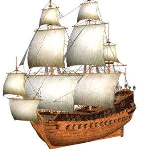

# 🚢 Ladice

*Ladice* is Slovenian for "little boats". This repo holds two games about a small boat on a night sea, made twelve years apart.

| Project | What it is | Stack |
|---|---|---|
| [`ladice-classic/`](ladice-classic) | The original: my first game, written in high school at Vegova. Kept as a museum piece, only patched to build on Linux. | C++17, SDL2, Make |
| [`lantern-tide/`](lantern-tide) | **Ladice: Lantern Tide**, a new game built on the original's ideas: lantern-lit fog of war, ramming pirates, sparing the animals. Runs in the browser. | TypeScript, Phaser 3, Vite |

<p align="center">
  
</p>

**▶ Play Lantern Tide in your browser: https://rp9376.github.io/Ladice/**

## Quick start

**Classic** (needs SDL2 dev packages, see its [README](ladice-classic/README.md)):

```bash
cd ladice-classic
make run
```

**Lantern Tide** (needs Node 22):

```bash
cd lantern-tide
npm install
npm run dev    # http://localhost:5173
```

## Layout

```
.
├── ladice-classic/      original C++/SDL2 game (src/, include/, assets/, Makefile)
├── lantern-tide/        the successor (src/, tests/, design notes in PLAN.md)
└── .github/workflows/   pages.yml builds lantern-tide and publishes it to GitHub Pages
```
